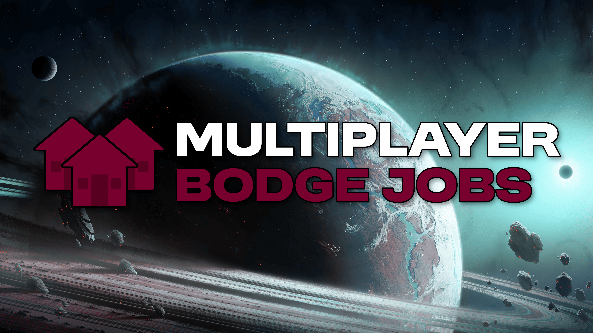

Multiplayer Bodge Jobs is a collection of patches for [Multiplayer](https://github.com/rwmt/Multiplayer/). It's like MPCompat except worse and very specific. Wow! It's intended for personal use.

## Notes
Thanks to Pardeike for making [Harmony](https://github.com/pardeike/Harmony) and RevenantX for creating [LiteNetLib](https://github.com/RevenantX/LiteNetLib).

## AI Disclosure

I have been using deepseek to simplify checking traces, and to assist me in pulling up relevant files which fire errors. Some of the code is written by me, some is written by Deepseek and carefully verified by me. As time goes on and I learn more I intend to turn "some of" into "all of." If we let machines do the thinking for us we will die a miserable death indeed, hence all solutions are thought up by me and guided by BigData(tm) until I can take the training wheels off.
